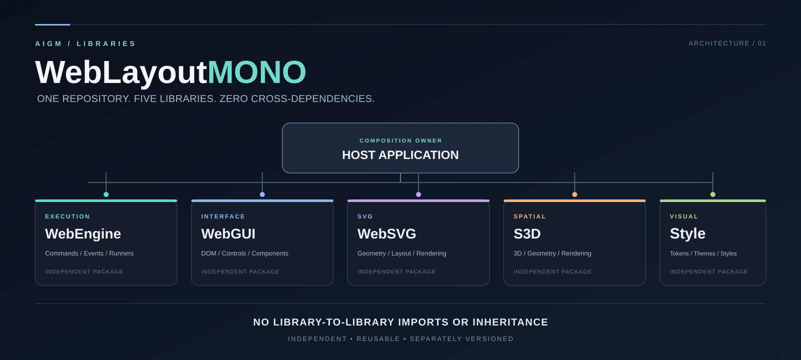

<p align="center">
  
</p>

# WebLayoutMONO

**One repository. Five independent libraries. Zero cross-library dependencies.**

WebLayoutMONO is the shared source-code home for AIGM's web libraries, including both general-purpose libraries and AIGM-specific ones. **It is a monorepo for organization and development, not a shared runtime, a framework bundle, or a monolith.** Every package is an independent unit with its own public API, version, tests and release lifecycle.

> **Non-negotiable:** Removing any other package directory must not prevent a remaining library from building or operating. A library must never import, inherit from, or require another WebLayoutMONO library.

## Architecture

The diagram above shows a **host application composing independent capabilities**. There are intentionally **no arrows between the libraries**.

| Package | Owns | Does **not** own |
| --- | --- | --- |
| **WebEngine** | AIGM-specific execution runtime for declared web structure, DWH projection consumption, SiteTree/navigation derivation, projectors, actions, and IAM/AccessCore integration adapters | Canonical DWH authority, IAM identity authority, AccessCore policy authority, or sibling-package implementations |
| **WebGUI** | Generic DOM/UI primitives and UI composition | Business rules, execution engine, host-specific state |
| **WebSVG** | SVG representation and rendering primitives, visual geometry | CW semantics, semantic projections, domain behavior, engine execution |
| **S3D** | Reusable spatial/3D representation and rendering primitives | Host/domain semantics and engine execution |
| **Style** | Visual tokens, themes and reusable style rules | Runtime logic, semantic authority or required sibling-package assets |

**Functional behavior and rendering are separate responsibilities.** A library's inclusion here is based on its being a web library, **not** on being general-purpose. Host-specific semantic projections stay in the consuming application/domain; no library is permitted to absorb them merely because the application needs the feature.

### WebEngine applicability

**WebEngine is AIGM-specific, not a general-purpose web framework.** Its current runtime and contracts assume AIGM's DWH-derived structure and integration boundaries (including IAM and AccessCore). Using it outside AIGM would require substantial adaptation; monorepo membership does not imply broad drop-in reusability.

**Independence is a different property from generality:** WebEngine must remain functional without any *other WebLayoutMONO package* present. This requirement does not erase its AIGM-specific contracts or external integration interfaces. A host can supply or adapt those external capabilities without introducing a dependency on a sibling library.

The longer-term AIGMos execution-core direction and separation of browser/DOM composition are architectural goals, not claims about the current implementation. The current WebEngine README describes the actual AIGM-focused runtime.

## Dependency boundary

```text
                        AIGMos / Structure / any host
                                     |
                host explicitly composes selected capabilities
                                     |
             +------------+----------+----------+------------+
             |            |          |          |            |
         WebEngine      WebGUI     WebSVG       S3D         Style

          NO sibling-package imports, inheritance or runtime requirements
```

- A **host** may use one, several or all packages.
- A package may expose a generic interface that the **host** connects to another component; this does not create a package-to-package dependency.
- An event, command or data contract must not require knowledge of a sibling package's classes, paths or internal structures.
- Do not introduce shared utilities as a hidden required sixth package. Each package must remain independently distributable.
- No cross-package relative imports, build-time coupling, shared runtime bootstrap or coordinated release requirement.
- A library's **own internal modules** are permitted dependencies; the prohibition applies between sibling libraries.
- External APIs and browser/OS primitives are environment capabilities, not sibling-library dependencies. WebEngine's **core** must not require browser-only globals.

## Target repository layout

```text
WebLayoutMONO/
├── assets/
│   └── web-layout-architecture.svg
├── WebEngine/
├── WebGUI/
├── WebSVG/
├── S3D/
├── Style/
└── README.md
```

**Migration status:** The five package directories now contain **byte-for-byte source snapshots** of the existing standalone repositories (including their contracts, demos, tests and existing license files). The original repositories remain untouched. **This is an import, not a completed architectural refactor:** current cross-cutting concerns (notably WebEngine browser/DOM composition and WebSVG semantic projection logic) still require separation. Do not treat these snapshots as validated, release-ready replacements for the upstream deployments.

Current upstream implementations:

- [WebEngine](https://github.com/Th3Hypn0tist/WebEngine)
- [WebGUI](https://github.com/Th3Hypn0tist/WebGUI)
- [WebSVG](https://github.com/Th3Hypn0tist/WebSVG)
- [S3D](https://github.com/Th3Hypn0tist/S3D)
- [Style](https://github.com/Th3Hypn0tist/Style)

## Migration order

1. **Inventory:** distinguish generic primitives, engine behavior, semantic projection logic and domain-specific code before copying anything.
2. **Clean boundaries:** eliminate dependencies between sibling libraries; isolate browser/DOM concerns from any planned browser-independent WebEngine core, while preserving its intentional AIGM integration scope; separate host-owned semantic projection behavior from reusable WebSVG primitives.
3. **Consolidate ownership:** the initial sources are now copied into independent package directories; continue development in one chosen source of truth per package, then retire legacy repository update paths only after explicit cutover. Preserve provenance and licensing.
4. **Prove independence:** run each package's own build and tests with every sibling package absent; reject forbidden cross-package imports.
5. **Publish independently:** packages receive independent versions, changelogs and releases; consuming applications choose versions explicitly.
6. **Resume Structure integration:** only after the libraries provide stable, explicitly scoped interfaces appropriate to their actual responsibilities. Structure's working migration branch remains separate.

## Scope

**In scope:** web libraries, both general-purpose and AIGM-specific. General applicability is documented per package rather than assumed from monorepo membership.

**Out of scope:** Structure's canonical CW model, Structure's semantic projection logic, AIGMos domain definitions, IAM/AccessCore/DWH semantic authority, application-specific editors and site implementations. Those belong to their respective systems and may **use** libraries from this repository without becoming part of them.

## Distribution and licensing

Monorepo placement **does not change the licenses or redistribution rights** of the original libraries. Preserve each project's existing notices and license terms (in particular, do not assume S3D is open source). Evaluate licensing per package before distributing a combined checkout.

---

<p align="center"><sub>AIGM · Structure by separation · Independent by design</sub></p>
